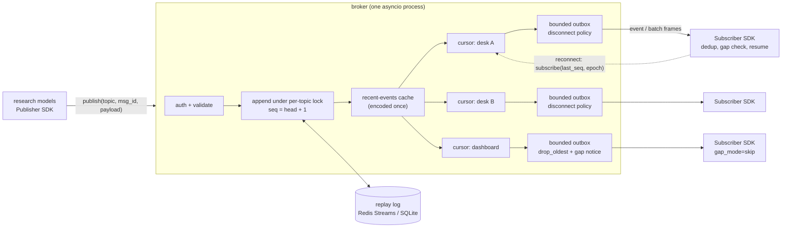

# realtime-signal-broker

[](https://github.com/Avinash186200/realtime-signal-broker/actions/workflows/ci.yml)
[](LICENSE)


A WebSocket broker that pushes model signals to many subscribers in real time, with per-topic sequence numbers, a durable replay log (Redis Streams in production, SQLite or memory for tests), token auth, and a client SDK that reconnects, resumes, de-duplicates and detects gaps. Tested by fault injection, and measured under load.

## Scenario

A research team produces model signals, scores and alerts, that several trading desks and dashboards must receive as they happen. Subscribers disconnect, fall behind or restart. A desk must never silently miss a signal or act on one twice; a dashboard would rather skip ahead than lag, but should know what it skipped. Ops needs to know how latency behaves as subscribers and message rates grow, and what happens to a subscriber that cannot keep up.

This is a scenario to frame the work. All signals are synthetic, made by a generator in the repo, and all numbers below come from code in this repo.

It is the push side of model serving. Two neighbouring pieces are in other repos of mine: [llm-serving-patterns](https://github.com/Avinash186200/llm-serving-patterns) covers request/response serving, and [intraday-market-data-pipeline](https://github.com/Avinash186200/intraday-market-data-pipeline) covers ingestion; this one covers distribution.

## What it does

| part | what I built | how it is judged |
|---|---|---|
| broker | asyncio + `websockets`. HS256 tokens with a role and topic patterns, per-topic gap-free sequence numbers, replay from a client's `last_seq`, app heartbeats plus ping/pong, a bounded queue per subscriber with a `disconnect` or `drop_oldest` policy, batch frames under load, graceful shutdown, `/metrics` and `/healthz` | fault-injection suite, unit and integration tests |
| replay log | Redis Streams (atomic Lua append, idempotency keys, epoch), SQLite (durable, single node), memory (tests); one contract test suite for all | same tests on each; the scenario suite on SQLite, fakeredis and a real Redis |
| publisher API | WebSocket publish role with idempotency keys: a retry after a lost ack returns the original seq instead of a second copy | lost-ack fault test; every scenario checks the log holds each `msg_id` once |
| client SDK | reconnect with exponential back-off and full jitter, resume from `last_seq` with an epoch check, dedup, gap detection (re-sync from the log, or skip and report), heartbeat timeout, cursor stores, typed pydantic payloads, versioned protocol | hypothesis property tests on a lossy connection model and on random fault schedules |
| benchmarks | a fault-injection proxy and seeded scenarios; a multi-process load generator | `results/correctness.json`, `results/load.json` |
| ops | Prometheus metrics (drops, lag, reconnects/resumes, slow-consumer disconnects, append-to-send latency), Dockerfile, docker-compose with Redis | metrics test; compose run |

## How it works



- **One code path for replay and live.** Each subscription is a cursor that reads "everything after my last seq": from the in-memory cache of recent encoded frames when it can, from the log when it has fallen further behind. So a reconnect with `last_seq` gets exactly the missed messages, then live ones, with no hand-off race.
- **The publisher never waits for a subscriber.** A slow subscriber only fills its own outbox. Under `disconnect`, if that outbox stays full for `slow_grace_s` the broker closes it with code 4008 and the SDK resumes from its last seq (no loss, a replay). Under `drop_oldest`, the oldest queued events are dropped and a `gap` notice takes their place; the SDK either re-fetches the range from the log or reports it. A catch-up replay is always paced by the consumer, because the backlog lives in the log, not in broker memory.
- **The SDK hands the application seq 1, 2, 3, ... per topic.** Duplicates (seq ≤ last) are dropped; a hole (seq > last + 1) triggers a re-sync from the log. A log reset (new epoch) or trimmed history is reported as a gap with a reason, never skipped silently.
- **Idempotent publishing.** The ack is sent after the append. Until it arrives the SDK keeps the message and re-sends it, with the same `msg_id`, after a reconnect.

The wire protocol, close codes and the exact delivery guarantee are in [docs/protocol.md](docs/protocol.md).

## Results

Everything below is from synthetic signals, copied from [results/RESULTS.md](results/RESULTS.md). How each number is made is in [docs/methodology.md](docs/methodology.md). `make bench` rebuilds the correctness results, and CI reruns the whole suite and checks every deterministic field against the committed JSON (with the versions in `constraints.txt`; I also ran the full test suite, including that rerun, in a `python:3.11-slim` Linux container).

### 1. Correctness under faults

Each scenario: a broker behind a fault-injection proxy, one publisher, six subscribers on two topics, 5,600 messages (a 600-message stream plus a 5,000-message burst while three subscribers stall), and six seeded faults from: cut every TCP connection mid-stream, network partition (cut and refuse new connections for 150-400 ms), broker crash (no close handshake, new broker on the same log), graceful broker restart, and application restart from a cursor file. After the stream, each subscriber's received sequence is compared with `[1..head]`.

| seeds | scenarios passed | messages | faults injected | exact streams | missing | duplicates | out of order | skip mode: unaccounted / both | duplicate msg_ids in log |
|---|---|---|---|---|---|---|---|---|---|
| development, SQLite log | 10/10 | 56,000 | cut 10, partition 14, crash 12, restart 12, app restart 12 | 100/100 | 0 | 0 | 0 | 0 / 0 | 0 |
| development, Redis Streams log (fakeredis, runs in CI) | 5/5 | 28,000 | cut 6, partition 8, crash 5, restart 6, app restart 5 | 50/50 | 0 | 0 | 0 | 0 / 0 | 0 |
| development, Redis Streams log (Redis 7 in Docker, local only) | 10/10 | 56,000 | cut 10, partition 14, crash 12, restart 12, app restart 12 | 100/100 | 0 | 0 | 0 | 0 / 0 | 0 |
| **held-out (seeds 200-219), SQLite log** | **20/20** | 112,000 | cut 22, partition 22, crash 29, restart 19, app restart 28 | **200/200** | 0 | 0 | 0 | 0 / 0 | 0 |

"Exact streams" counts (subscriber, topic) pairs whose received sequence was exactly `1..head`, for the five subscribers that must see everything. The sixth is a dashboard in skip mode: every seq it did not receive must be inside a gap it was told about ("unaccounted" = neither received nor reported, "both" = received and also reported). The faults did happen: on the held-out seeds the subscribers reconnected 393 times, the broker closed 20 stalled subscribers under the `disconnect` policy, and it dropped 84,068 queued events under `drop_oldest`, all recovered from the log by the re-sync dashboard or reported to the skip dashboard (11,349 seqs in reported gaps). These counts depend on timing and are not checked by tests; the zeros in the table are.

**This was not clean the first time, and the held-out row is the second held-out set.** Seeds 100-119 passed 20/20 on the first version. After I reworked the hot path for throughput (section 2), a re-run of seed 103 failed: an application restarted from its cursor file received 20 messages twice, because `Subscriber.close()` flushed the cursor before it stopped handing out buffered messages. I fixed it, added a regression test that fails on the old code, and, since seed 103 had now guided a fix, ran a fresh held-out set (200-219) once on the final code. The real-Redis run also found a bug that fakeredis could not: reading an empty stream and its head counter in two round trips let an append slip in between, so new subscribers skipped seq 1 (fixed with one `MULTI/EXEC`). And an independent review then found a silent-loss bug none of the scenarios hit: after a log reset, the SDK could save the *new* epoch with an *old* seq for a message still in its buffer, so a restarted application skipped new-epoch messages without a gap report. The cursor now stores each delivery's own epoch, with a regression test that fails on the old code; the same review added tests that crash and stop the broker with 200 publishes in flight (they passed without changes). Details in [CHANGELOG.md](CHANGELOG.md). From 1.0.0 on, seeds 200-219 run in CI on every change, so they are regression seeds now, not held-out ones.

What the suite does not show: it never sends a duplicate publish through the idempotency path by itself (0 in every run: no ack happened to be lost at a bad moment), so that path is covered by a targeted test that cuts the connection right after the append. And 0 duplicates dropped by the SDK means the broker never re-sent an already-delivered seq in these runs; the SDK's dedup is covered by the property tests instead.

### 2. Latency and throughput (one laptop, Windows)

Intel Core Ultra 9 185H (22 logical CPUs), Windows build 26200, Python 3.11.9. The broker, the publisher and the subscriber processes all run on this one machine. The publisher is open loop at the target rate; latency is publisher send to subscriber parse, over 5 s after 1 s of warm-up.

| log | subscribers | msg/s | deliveries/s | p50 ms | p95 ms | p99 ms | lost | duplicates |
|---|---|---|---|---|---|---|---|---|
| SQLite | 1 | 100 | 100 | 2.6 | 3.7 | 5.9 | 0 | 0 |
| SQLite | 1 | 1,000 | 1,000 | 5.2 | 12.7 | 19.7 | 0 | 0 |
| SQLite | 10 | 100 | 1,000 | 4.0 | 6.1 | 16.2 | 0 | 0 |
| SQLite | 10 | 1,000 | 10,000 | 7.9 | 18.7 | 32.8 | 0 | 0 |
| SQLite | 100 | 100 | 10,000 | 13.1 | 23.8 | 28.2 | 0 | 0 |
| SQLite | 100 | 1,000 | 100,000 | 94.9 | 145.7 | 163.5 | 0 | 0 |
| SQLite | 500 | 100 | 50,000 | 176.6 | 258.5 | 294.4 | 0 | 0 |
| SQLite | 1 | 5,000 | 5,000 | 351 | 657 | 692 | 0 | 0 |
| SQLite | 10 | 5,000 | 50,000 | 741 | 1,959 | 2,016 | 0 | 0 |
| SQLite | 100 | 2,000 | 200,000 | 2,268 | 3,605 | 3,721 | 0 | 0 |
| memory | 1 | 1,000 | 1,000 | 2.4 | 4.3 | 11.0 | 0 | 0 |
| memory | 10 | 1,000 | 10,000 | 4.3 | 6.6 | 8.9 | 0 | 0 |
| memory | 100 | 1,000 | 100,000 | 44.4 | 89.1 | 109.3 | 0 | 0 |
| Redis, `appendfsync everysec` | 1 | 1,000 | 1,000 | 17.0 | 105.6 | 120.8 | 0 | 0 |
| Redis, `appendfsync everysec` | 10 | 1,000 | 10,000 | 1,611 | 3,390 | 3,511 | 0 | 0 |
| Redis, `appendfsync everysec` | 100 | 1,000 | 100,000 | 33,269 | 64,661 | 67,389 | 0 | 0 |
| Redis, `appendfsync always` | 1 | 1,000 | 1,000 | 5,032 | 8,309 | 8,535 | 0 | 0 |
| Redis, `appendfsync always` | 10 | 1,000 | 10,000 | 5,267 | 9,356 | 9,951 | 0 | 0 |
| Redis, `appendfsync always` | 100 | 1,000 | 100,000 | 36,379 | 68,846 | 71,610 | 0 | 0 |

Redis 7 ran in Docker Desktop's VM on the same laptop, with `maxmemory-policy noeviction`.

What I read from this:

- **Up to about 10,000 deliveries a second the broker keeps single-digit-millisecond medians** on the SQLite log (10 subscribers at 1,000 msg/s: p50 7.9 ms, p99 32.8 ms). At 50,000-100,000 deliveries a second it still delivers everything, but medians reach about 100-180 ms. Beyond that (200,000 a second, or 5,000 msg/s into the SQLite log) it is saturated and latency is queueing, in seconds.
- **Run-to-run noise on a laptop is large at the saturated end.** The previous run, an hour earlier on code that differed only by the review fixes (none of which adds work per message beyond one comparison), gave 1.2 s instead of 2.3 s median at 100 subscribers × 2,000 msg/s, and 51 ms instead of 95 ms at 100 × 1,000. The table is the latest run; treat the overloaded rows as "seconds" or "around 100 ms", not as exact values. The unsaturated medians moved by a millisecond or two.
- **The Redis backend is the weak spot, and the durable setting makes it much worse.** With `appendfsync always`, which is what you need for "an acked message survives a Redis crash" (see docs/protocol.md), Redis fsyncs every append; in Docker Desktop's VM that capped this broker at a few hundred publishes a second, so even one subscriber at 1,000 msg/s fell seconds behind. With `everysec` (up to about a second of acked messages can be lost on a Redis crash) one subscriber is fine (p50 17 ms) but 10 already fall behind: each publish waits for one Redis round trip under the topic lock, and while it waits the broker cannot batch consecutive publishes the way it does with SQLite. Pipelining appends is the obvious next step, and a Redis on a Linux host with a fast disk would do better; I measured neither. On this setup the Redis backend is good for durability, not for high fan-out.
- **Every row has 0 lost and 0 duplicates**, checked independently in each subscriber process, including the saturated ones: overload costs latency, not correctness.
- **The first version was far worse.** Before batching and before removing a forced task switch per publish, 10 subscribers at 1,000 msg/s had a p50 of 2.5 s. The fix, and why it worked, is in the CHANGELOG. I re-ran every row after the change, not just the one that improved.

### 3. Catch-up after an outage

A subscriber offline for 5 s while 1,000 msg/s are published (SQLite log) missed 5,028 messages; after reconnecting it replayed them in 61 ms, and over the whole 10,000-message run it had 0 lost and 0 duplicates.

## Key concepts

- **At-least-once on the wire, once in order to the application.** The broker may send a message again (after a reconnect, a re-sync); the SDK keys on `(epoch, topic, seq)` and drops repeats. "Exactly once" end to end also needs the application's own side effects to be idempotent, because a crash between acting and committing the cursor replays the last messages.
- **Sequence numbers, not timestamps.** Gaps are visible only if numbers are contiguous, so seqs are assigned per topic under a lock, by an atomic append (a Lua script on Redis).
- **Epochs.** A log that lost its data (an in-memory broker restart) restarts seqs at 1. Without an epoch, a client at seq 500 would drop new messages 1-500 as "duplicates". With one, it sees a reset and reports it.
- **Heartbeat vs ping/pong.** Ping/pong checks the TCP path; app heartbeats check that the broker's event loop is alive and carry per-topic heads, so a client can see its own lag.
- **Back-off with full jitter.** After a broker restart, every client reconnects; random delays in `[0, min(cap, base·2^n)]` spread them out instead of stampeding the new broker.
- **Slow-consumer policy is a business choice.** A desk wants every message (disconnect and replay); a dashboard wants the latest (drop and report). Both are per connection.
- **Backpressure has more buffers than you think.** Before a stalled subscriber fills its broker queue, the operating system's socket buffers absorb a lot of traffic. On this laptop's loopback that was over a thousand small frames per connection, which is why the stall in the scenarios is 5,000 messages.

## Quick start

```bash
pip install -c constraints.txt -e ".[dev]"   # exact versions the results were made with
pytest -q -m "not slow"                      # about 30 s
pytest -q                                    # adds the full correctness rerun: about 4 min here, 2 min on Linux
make demo                                    # broker + publisher + desk + dashboard, with a cut link and a crash
make bench                                   # correctness suite -> results/correctness.json
make load                                    # latency grid on your machine -> results/load.json
```

Run the broker yourself:

```bash
export SIGBROKER_SECRET=$(python -c "import secrets; print(secrets.token_hex(32))")
sigbroker serve --backend sqlite:signals.sqlite              # or --backend redis://localhost:6379/0
sigbroker publish --topic signals.rates --rate 5             # synthetic signals
sigbroker subscribe --topic signals.rates --cursor-file desk.cursor
curl -s localhost:8765/metrics | grep sigbroker_
```

With Docker (Redis 7 + broker; `--profile demo` adds a publisher and a subscriber):

```bash
docker compose --profile demo up --build
```

From Python:

```python
from sigbroker import Publisher, Subscriber, ScoreSignal
from sigbroker.client import FileCursorStore

async with Publisher(url, publisher_token) as pub:
    await pub.publish("signals.rates", ScoreSignal(model="carry", instrument="UST10Y", value=1.3, as_of=now),
                      msg_id="carry-UST10Y-2026-01-05T14:30")

async with Subscriber(url, desk_token, ["signals.rates"], cursor_store=FileCursorStore("desk.cursor")) as sub:
    async for d in sub:
        handle(d.topic, d.seq, d.signal)
```

The secret is only ever read from `SIGBROKER_SECRET`; tests and the demo generate one at runtime.

## Layout

```
src/sigbroker/
  schema.py       wire protocol: pydantic frames, signal payloads, versioning
  auth.py         HS256 tokens, roles, topic patterns
  broker.py       sessions, cursors, cache, heartbeats, shutdown, /metrics and /healthz
  outbox.py       bounded per-subscriber queue, disconnect and drop_oldest policies
  backends/       memory.py, sqlite.py, redis.py (Redis Streams + Lua), base.py (the contract)
  client.py       Subscriber SDK: back-off, resume, dedup, gap tracking, cursor stores
  publisher.py    Publisher SDK: idempotency keys, in-order re-send
  metrics.py      Prometheus registry and the lag collector
  chaos.py        TCP fault-injection proxy
  scenarios.py    seeded fault scenarios (the correctness suite)
  loadgen.py      multi-process load generator and the catch-up measurement
  synthetic.py    synthetic score and alert generator
  bench.py        runs both benchmarks, renders RESULTS.md
  demo.py, cli.py
tests/            schema, auth, backend contract, outbox, client logic (hypothesis), broker, faults (hypothesis), bench, CLI
results/          correctness.json, correctness_redis.json, load.json, RESULTS.md
docs/             protocol.md, methodology.md
```

## Limitations

- **One broker process.** Fan-out, the cache and the per-topic head live in one asyncio process. Two brokers on the same Redis would each assign seqs correctly (the Lua append is atomic) but would not see each other's publishes to fan out. A subscriber that moves to a broker whose idea of the head is older than its own cursor would even get a fatal `seq_ahead`. Scaling out needs each broker to tail the streams (`XREAD BLOCK`) or a partitioning of topics across brokers. Python's single event loop also caps throughput, as the load table shows.
- **The Redis backend does not scale with fan-out yet** (section 2): one round trip per publish under a lock, no pipelining, and with `appendfsync always` one fsync per publish. And the Redis rows were measured against Redis in Docker Desktop on Windows, not on a Linux host. The backend assumes one Redis primary with `maxmemory-policy noeviction` and AOF persistence (`appendfsync always` in the compose file); with eviction, `everysec`, or failover to an asynchronous replica, acked messages can be lost while the epoch survives, which the SDK cannot detect (see docs/protocol.md).
- **The load numbers are one Windows laptop with everything on it.** No network between machines, no TLS, and subscriber processes compete with the broker for CPU. Windows' event loop has a 15.6 ms timer, so the open-loop publisher sends in small bursts; on Linux the low-rate medians would likely be lower. I did not run the load grid on Linux. There is no k6 script: the Python load generator measures the same things and runs in CI as a smoke test.
- **The scenarios are seeded but not a proof.** They inject faults at message boundaries in a single process on localhost. They do not model packet loss with retransmission delays, clock jumps, disk-full, a Redis failover (and its possible loss of the last writes with asynchronous replication), or a broker that hangs without dying. The "held-out" seeds guard against tuning to my own debug runs, not against fault types the suite does not generate.
- **SQLite durability is per process crash, not power loss** (`synchronous=NORMAL`), and SQLite calls run on the event loop. It is the single-node option, not a production one.
- **Idempotency has a window.** The Redis idempotency key expires after 24 h; SQLite remembers a `msg_id` while the message is retained, and the memory log the last 100,000 `msg_id`s per topic. A publisher retrying the same message after that gets a new seq.
- **Slow-consumer detection acts late on fast local networks.** Socket buffers hold over a thousand small frames before a stalled subscriber's broker queue fills, so `max_queue` alone understates how far behind a subscriber can be before the policy fires. A stalled subscriber with a full queue and no new traffic is not disconnected until the next message arrives (harmless, but it shows in the lag metric).
- **Auth is a shared HMAC secret.** Fine for one team; across organisations you would want asymmetric keys (RS256/EdDSA) so subscribers cannot mint tokens, plus key rotation. Tokens are checked at connect and on expiry, not revoked mid-session.
- **The cursor file is at-least-once after a crash.** It is written at most every 250 ms; an application crash replays up to that much. Applications that place orders should also de-duplicate on `(topic, seq)` in their own store.

## License

MIT. See [LICENSE](LICENSE).
